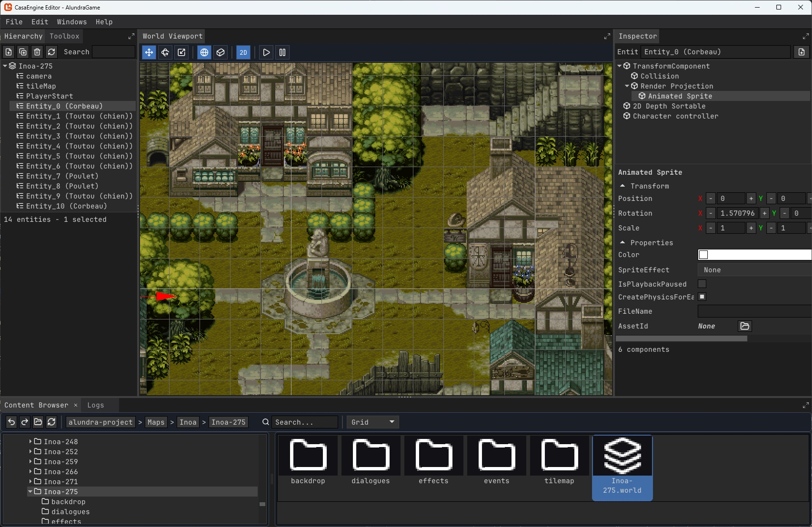
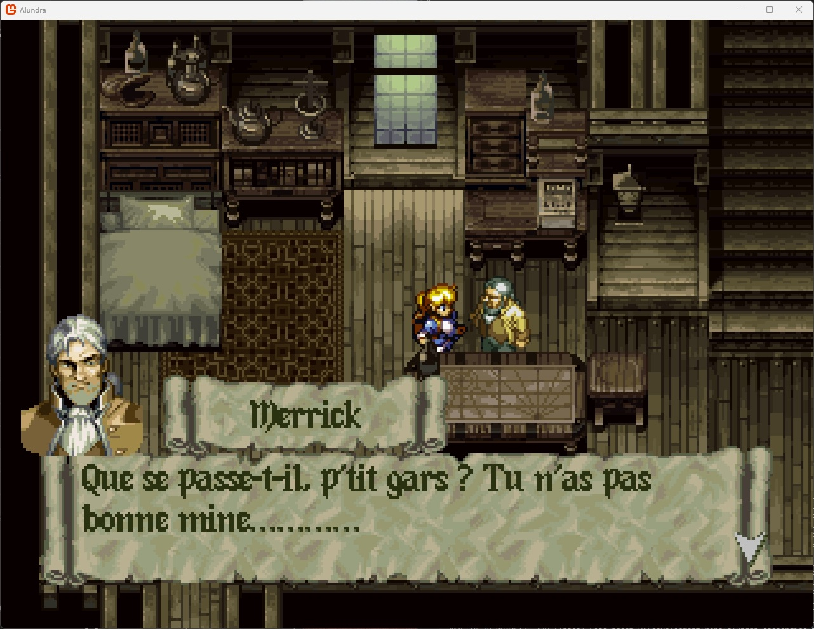
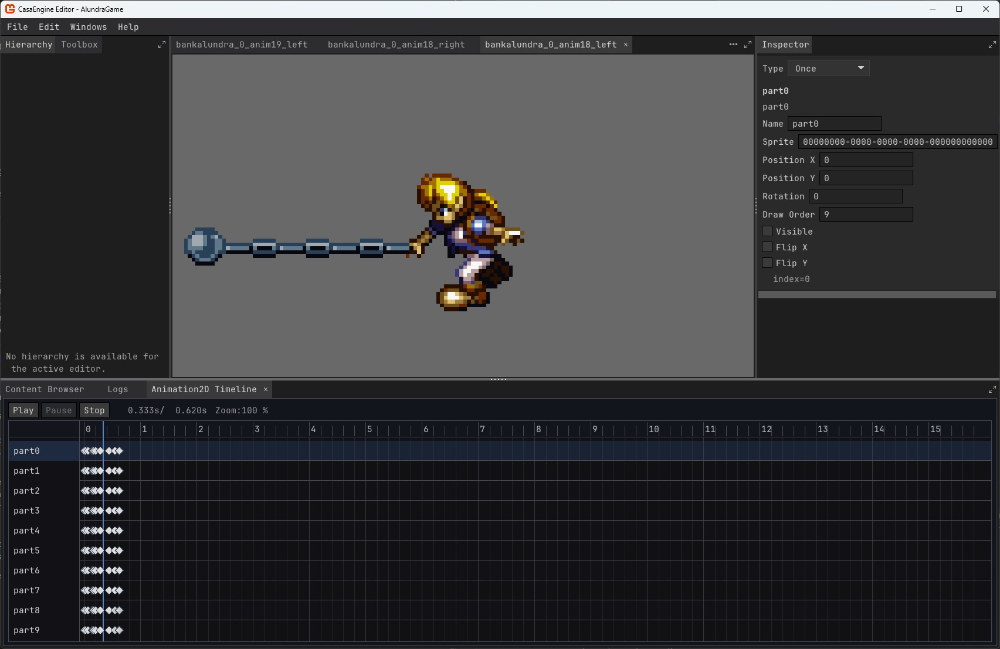
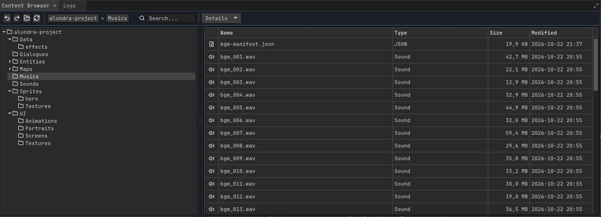
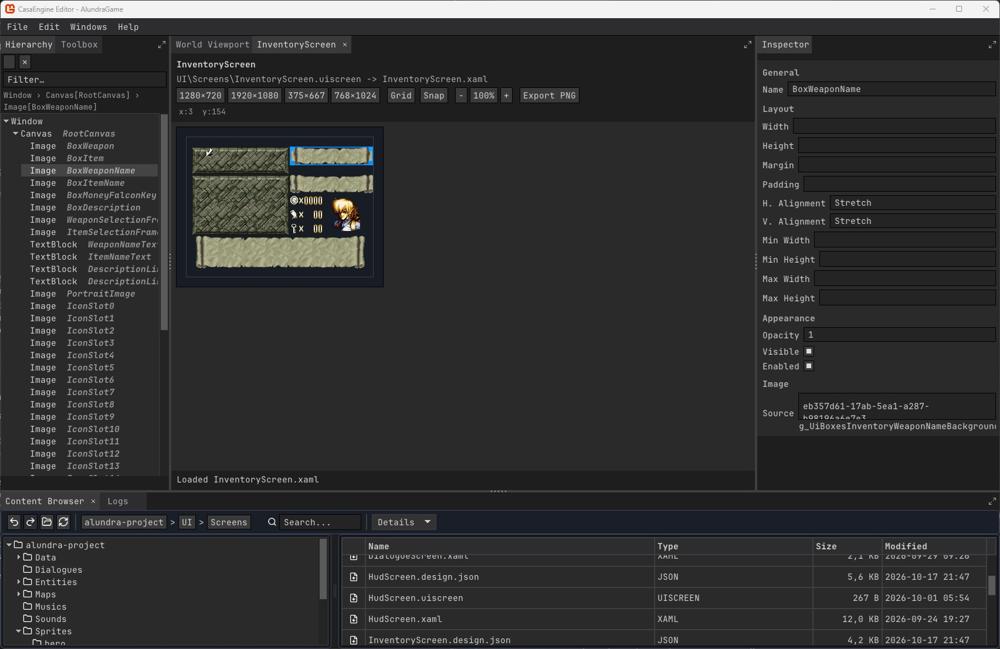

# Alundra port on CasaEngine

  

**Bringing Alundra into a modern game engine.**

This project aims to rebuild Alundra as a fully structured, editable and extensible game project using [CasaEngine](https://github.com/xcasadio/CasaEngineMonogame), a C# game engine built on MonoGame.
Rather than emulating the original PlayStation hardware or simply reproducing its visuals, the goal is to bring the game's entire world, assets and systems into a modern game development environment: worlds, entities, components, physics, rendering, animations, dialogues, gameplay systems and asset management.

## Modernizing Every Game System

### Worlds and Level Design

The original locations are recreated as independent CasaEngine worlds in the [Tiled](https://www.mapeditor.org/) format.
Maps, tile layers, entities, portals and environmental properties are organized using a modern world and scene architecture.

  

### Rendering and Visuals

The original 2D graphics are integrated into CasaEngine's rendering architecture.
Sprites, textures, tilemaps, animation frames, image transformations and scrolling background layers are represented as engine resources.

  

### Physics and Collisions

Alundra's original collision geometry is represented using CasaEngine's component-based collision system.
Entity bodies and animation-dependent collision volumes become modern physics components and collision timelines.

### Animations and Characters

Characters, enemies and other animated objects are organized as reusable assets.
Their original animations are represented using CasaEngine's animation system, including individual sprite parts, transformations, timing and collision keyframes.

  

### Dialogues, Events and Gameplay

The game's dialogue content is integrated with **Yarn Spinner**, providing a modern dialogue authoring and execution environment.

### Asset Management

The original game's content is organized into a modern asset library.
Textures, sprites, animations, audio, dialogues, UI elements and worlds are managed as individual resources, with centralized asset references and logical project organization.

  

### Audio

Music, sound effects, fonts, interface graphics and other visual resources are brought into the CasaEngine project.

### User Interface

Interface graphics are converted to xaml compatible with [MGUI](https://github.com/xcasadio/MGUI).

  

## A Complete Game World, Rebuilt

Alundra is no longer just a collection of PlayStation-specific data. Its content is reconstructed as a native CasaEngine project, where game elements are organized into independent, reusable and editable resources.

A full conversion already produces:

| | Converted content |
|---|---|
| **483** | Game maps and worlds |
| **9,620** | 2D animations |
| **~21,000** | Registered game assets |
| **395** | Sprite banks |
| **9,741** | Map entity instances |
| **3,316** | Portals |
| **1,714** | Map events |
| **1,041** | Audio files |

These figures represent an actual full project conversion, not estimated targets.

## Powered by CasaEngine

[CasaEngine](https://github.com/xcasadio/CasaEngineMonogame) is an open-source C# game engine built on top of MonoGame.

It provides a game development environment with an integrated editor and a component-based architecture:
- **World and entity management** - structured scenes and reusable game objects.
- **2D rendering and animation** - sprites, tilemaps and animation timelines.
- **Physics** - collision geometry and physics components.
- **Asset management** - centralized resources and asset references.
- **Game UI** - interface development through MGUI.
- **Gameplay architecture** - extensible C# game systems.

## Project Status

- ✅ Data conversion completed
- ❌ Export data from ISO files (`.iso` and `.bin`)
- **Implementation**
  - ✅ Maps
  - ✅ Sprites
  - ✅ Animations
  - ✅ Collision geometry
  - ✅ Dialogue text
  - ✅ Audio assets
  - ⏳ Event scripts
  - ⏳ Gameplay interactions
  - ⏳ AI behaviors
  - ✅ Camera logic
  - ❌ Movies

## Prerequisites

- **.NET 9 SDK** (`net9.0-windows`).

## Related Projects

- [CasaEngine](https://github.com/xcasadio/CasaEngineMonogame) - The modern C# / MonoGame engine and editor.
- [Alundra Data Analyser](https://github.com/xcasadio/alundra-datas-analyser) - Reverse engineering, analysis and extraction of the original PlayStation game data.

## License

Source code is released under the **MIT License**.  Original *Alundra* assets remain the property of their respective rights holders and are **not** included in this repository.

## Legal Notice

Alundra is the intellectual property of its respective rights holders.
This is an independent, unofficial fan and reverse-engineering project, not affiliated with or endorsed by the original creators or publishers.
Original copyrighted game assets are not distributed as part of this project. A legally obtained copy of the original game is required to extract its content.
